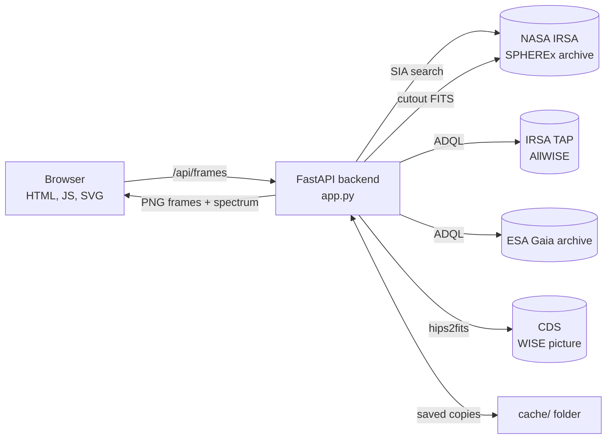

# SPHEREx Sky Blink

**A public web tool that plays NASA SPHEREx's infrared sky as a short film, so anyone can spot what moves.**

Built for the NASA hackathon challenge: *"Create a public-facing web tool to display images of the sky from the SPHEREx mission, making it easy for anyone to quickly see how they change over time."*

You enter the coordinates of a patch of sky (or click a preset). The tool finds every SPHEREx image covering that spot, cuts out the patch, aligns the images onto one common grid, and plays them like a blink comparator. Stars hold still. Comets, asteroids, brown dwarfs and variable stars stand out.

---

## Contents

1. [Features](#features)
2. [Quick start for judges and evaluators](#quick-start-for-judges-and-evaluators)
3. [Running without internet or when IRSA is down (saved copies)](#running-when-irsa-is-down-saved-copies)
4. [How to use the interface](#how-to-use-the-interface)
5. [Test targets](#test-targets)
6. [URL parameters and embedding](#url-parameters-and-embedding)
7. [How it works](#how-it-works)
8. [API reference](#api-reference)
9. [Everything used in this project](#everything-used-in-this-project)
10. [Project structure](#project-structure)
11. [Troubleshooting](#troubleshooting)
12. [Known limitations](#known-limitations)
13. [Future work](#future-work)
14. [Credits and licence](#credits-and-licence)

---

## Features

- **Blink film of any sky position:** RA/Dec in degrees or `08h55m10.8s / -07d14m42s`, or one-click presets.
- **Choose the field of view:** 2 to 30 arcminutes. Larger fields keep faster movers in frame but download more data.
- **Six detector bands:** D1 to D6 (0.75 to 5.0 micron), or all six.
- **Subtract static sky:** removes each detector's median image, so movers appear as a bright and dark pair.
- **Add exposures:** average 1, 2, 4 or 8 consecutive exposures to cut noise.
- **Stack per detector:** add every exposure from one detector array into one deeper image (six images, one per band).
- **Spectrum on the fly:** flux at the target position versus wavelength, built from the frames you are viewing.
- **Gaia DR3 and AllWISE overlays:** compare SPHEREx against known stars and WISE sources.
- **Metadata on every frame:** observation time, detector, wavelength, noise estimate, percentage of flagged pixels, field size, number of visits.
- **WISE context picture** of the same field, with an interactive Aladin Lite view.
- **Shareable and embeddable:** every setting lives in the URL, plus an `embed=1` mode.
- **Works through IRSA outages:** saved copies of the demo targets are served automatically if IRSA stops responding.
- **No API keys, no login, no build step.**

---

## Quick start for judges and evaluators

### Requirements

- **Python 3.9 or newer** (developed on 3.9). Check with `python3 --version`.
- **Internet access** for live data, Google Fonts and the Aladin Lite script. (Saved-copy mode needs internet only for fonts and Aladin, and the page still works without them.)
- A modern browser (Chrome, Firefox, Safari, Edge).

### 1. Get the code

```bash
git clone <your-repo-url>
cd <repo-folder>
```

### 2. Create a virtual environment and install

**macOS / Linux**

```bash
python3 -m venv venv
source venv/bin/activate
pip install -r requirements.txt
```

**Windows (PowerShell)**

```powershell
py -m venv venv
venv\Scripts\Activate.ps1
pip install -r requirements.txt
```

> On macOS, plain `pip` and `python` may not exist outside a virtual environment. Use `python3` and `pip3` until the environment is activated. The install can take a few minutes because Astropy and SciPy are large.

### 3. Start the server

```bash
python -m uvicorn app:app --port 8000
```

### 4. Open the tool

Go to **http://localhost:8000** in your browser. Leave the terminal window open while you use the tool.

### 5. Try it (about two minutes)

1. Click **Barnard's Star** and press **Load frames**. The first load of a target can take up to a minute because cutouts are downloaded from IRSA.
2. Watch the film. Use Play/Pause, the slider, and the speed menu. Keyboard: `Space` plays or pauses, left and right arrows step through frames.
3. Switch **View** to *Subtract static sky*, then raise **Add exposures** to 4 and compare the noise value in the caption.
4. Tick **Gaia DR3** and **AllWISE** to overlay known sources.
5. Scroll to the **Spectrum** panel and the **WISE context view**.
6. Change **Field of view** to 12 and watch the film reload.

### Stopping and restarting

Press `Ctrl+C` in the terminal to stop. Next time:

```bash
cd <repo-folder>
source venv/bin/activate          # Windows: venv\Scripts\Activate.ps1
python -m uvicorn app:app --port 8000
```

---

## Running when IRSA is down (saved copies)

The tool depends on NASA's IRSA archive. IRSA occasionally returns errors (for example `502 Proxy Error`). To keep the demo working, the tool can save and reuse data on disk.

### What is saved

Everything is stored in the `cache/` folder next to `app.py`:

| File pattern | Contents |
|---|---|
| `raw_*.pkl` | Aligned SPHEREx cutouts and per-frame metadata for one position, field and band |
| `cat_*.json` | Gaia or AllWISE source lists for one field |
| `ctx_*.jpg` | The WISE colour context picture for one field |
| `names.json` | Resolved coordinates for target names such as "RW Aur" |

### The repository already includes saved copies

The `cache/` folder in this repository was generated on **[date]** for the five preset targets. Judges can therefore run the tool even if IRSA is unreachable.

### Behaviour, step by step

| Situation | What the tool does |
|---|---|
| **Normal start**, IRSA working | Tries IRSA first and shows live data. The result is also written to `cache/`. |
| **Normal start**, IRSA failing, saved copy exists | Tries IRSA once, then shows the saved copy. The caption adds **"SAVED COPY (IRSA unreachable)"**. Live is retried on the next load. |
| **Normal start**, IRSA failing, no saved copy | Retries up to 4 times, then shows: "IRSA's search service did not respond… try again in a minute." |
| **Offline mode** | Uses saved copies first and never waits on the network for anything saved. |

### Limits of saved copies

- Saved copies exist only for the **preset buttons at their preset settings**. A different field of view, band or position needs IRSA live.
- The **View**, **Add exposures**, **Overlays** and speed controls work from saved data.
- Saved copies are a snapshot. Data released after the snapshot is not included. Live loads always fetch fresh data.
- Keep the saved data private to the repository's purpose: it is a convenience copy of public IRSA data.

---

## How to use the interface

| Control | What it does | Effect on the result |
|---|---|---|
| **Target chips** | Five preset test objects | Fills RA/Dec, band and field size for you |
| **Right ascension / Declination** | Centre of the patch, in degrees or h m s / d m s | Sets the sky position |
| **Field of view (arcmin)** | Width of the patch, 2 to 30 | Larger keeps fast movers in frame but downloads more and loads slower |
| **Detector band** | D1 to D6 or all six | One band keeps colours consistent between frames. "All six" mixes wavelengths, so brightness varies |
| **View: Individual exposures** | One frame per exposure | Raw look at every visit |
| **View: Subtract static sky** | Subtracts each detector's median image | Static sky cancels. Movers appear as a bright and dark pair |
| **View: Stack per detector** | Averages all exposures from each detector | Six deeper images, one per band, for higher signal-to-noise |
| **Add exposures (1, 2, 4, 8)** | Averages consecutive exposures | Less noise, fewer frames |
| **Gaia DR3 / AllWISE** | Overlays catalogue markers (cyan circles, magenta boxes) | Shows known sources. Fast movers sit away from their markers |
| **Load frames** | Fetches and aligns the data | Field of view, band, view and exposure changes also reload automatically |
| **Play / slider / speed** | Controls the film | 1, 3 or 6 frames per second |
| **Orange ring** | Marks the position you entered | Reference for movers and for the spectrum |
| **Caption** | Frame number, time (UTC), detector, approximate wavelength, flagged-pixel %, noise estimate, field size, visits shown | Quality cues for each frame |
| **Spectrum panel** | Flux at the ring versus wavelength | One point per displayed frame. Meaningful only for a stationary source |
| **Context view** | WISE colour picture of the field | Press *Interactive* for a zoomable Aladin Lite map |

Colours in the spectrum are detectors D1 to D6. Hover a point for its wavelength, flux and detector.

---

## Test targets

The preset buttons match the challenge's test objects:

| Preset | How it is resolved | Notes |
|---|---|---|
| **Barnard's Star** | Name lookup (CDS Sesame), proper motion applied to epoch J2026 | Very fast mover (about 10 arcsec per year) |
| **ε Indi B** | Name lookup, proper motion applied | Brown-dwarf pair around ε Indi. Uses a 12 arcmin field. Pixels are about 6 arcsec, so the pair appears as one source |
| **WISE 0855** | `08h55m10.831s`, `-07d14m42.53s` as given in the challenge, no proper-motion correction | Fast-moving brown dwarf. Preset uses the 4.4 to 5.0 micron band |
| **RW Aurigae** | Name lookup | Variable star |
| **R Draconis** | Name lookup | Variable star |

---

## URL parameters and embedding

Every load updates the address bar, so any result is a shareable link. You can also write links by hand.

| Parameter | Meaning | Example |
|---|---|---|
| `target` | Preset id: `barnard`, `epsindib`, `wise0855`, `rwaur`, `rdra` | `?target=wise0855` |
| `ra`, `dec` | Custom position (degrees or sexagesimal) | `?ra=133.7951&dec=-7.2451` |
| `name` | Name resolved by CDS | `?name=RW%20Aur` |
| `fov` | Field of view in arcmin (2 to 30) | `fov=10` |
| `det` | `0` for all, or `1` to `6` | `det=6` |
| `view` | `frames`, `diff` or `bands` | `view=diff` |
| `bin` | Exposures averaged: 1, 2, 4, 8 | `bin=4` |
| `ov` | Overlays, comma separated: `gaia`, `wise` | `ov=gaia,wise` |
| `embed` | `1` hides the header and side panels | `embed=1` |

Example: `http://localhost:8000/?target=wise0855&view=diff&ov=gaia,wise`

Embed in another page:

```html
<iframe src="http://localhost:8000/?target=barnard&embed=1" width="620" height="760" style="border:0"></iframe>
```

---

## How it works



### Pipeline for one request

1. **Resolve the position.** RA/Dec are parsed with Astropy. Names are resolved through CDS Sesame and remembered in `cache/names.json`. Presets with proper motion are moved from J2000 to J2026.0 (26 years).
2. **Search IRSA.** An SIA query on the collections `spherex_dr1` and `spherex_qr3` returns every image covering the position. Results are grouped by detector (`SPHEREx-D1` to `D6`), sorted by time, and thinned to at most 20 per detector (6 per detector when "All six" is selected).
3. **Download cutouts.** Each image URL gets `?center=ra,decd&size=<degrees>`, so only the requested patch downloads. Up to 8 downloads run in parallel, with retries.
4. **Align.** Every cutout has its own orientation. Each is resampled with SciPy (`map_coordinates`, linear) onto a shared north-up tangent-plane grid at 6.15 arcsec per pixel, using the cutout's WCS.
5. **Measure.** For every frame the backend records the observation time, detector, wavelength at the target pixel (from the cutout's spectral WCS), the fraction of non-zero pixels in the `FLAGS` extension, and the central flux.
6. **Cache.** The aligned arrays are kept in memory and saved to `cache/`, so changing the view or averaging never re-downloads.
7. **Render.** By view mode:
   - *Individual*: median-subtract and apply an asinh stretch (2nd to 99.7th percentile).
   - *Subtract static sky*: subtract the per-detector median image, then a symmetric asinh stretch around zero.
   - *Stack per detector*: average all exposures from each detector.
   - *Add exposures N*: average consecutive frames within each detector.
   - Frames are flipped to north-up and encoded as PNG. A noise estimate (1.4826 x median absolute deviation) is computed for each.
8. **Spectrum.** Flux is the mean of the central 3x3 pixels minus the median of a surrounding ring (radius about 5 to 12 pixels), in MJy/sr. If a wavelength lookup fails, the detector's band centre (0.93, 1.37, 2.03, 3.12, 4.12, 4.71 micron) is used and the plot says so.
9. **Overlays.** The 400 brightest AllWISE (W1) or Gaia DR3 (G) sources within the field are fetched separately and drawn as SVG markers over the film.

### Resilience

- IRSA search: up to 4 attempts with growing waits, then a clear message.
- Cutout downloads: 3 attempts each.
- Catalogue queries: 3 attempts, then saved copy if present.
- Any unexpected server error is returned as readable JSON, with the full traceback printed in the terminal.

---

## API reference

| Endpoint | Parameters | Returns |
|---|---|---|
| `GET /` | none | The web page |
| `GET /bg.jpg` | none | Background image |
| `GET /api/frames` | `ra`, `dec` or `name`; `pmra`, `pmdec` (mas/yr); `size` (degrees, 0.02 to 0.5); `det` (0 to 6); `n` (3 to 60, default 20); `view` (`frames`, `diff`, `bands`); `bin` (1 to 16) | JSON with `ra`, `dec`, `size`, `source` (`live` or `saved`), `available` (visits found), `frames` (PNG data URLs plus time, detector, wavelength, flux, flags, noise) and `spectrum` |
| `GET /api/catalog` | `ra`, `dec`, `size`, `cat` (`gaia` or `wise`) | Up to 400 sources as `[ra, dec, magnitude]` |
| `GET /api/context` | `ra`, `dec`, `fov` (degrees) | JPEG of the WISE colour view |

---

## Everything used in this project

### NASA data and services (no API key required)

| Resource | Link | Used for |
|---|---|---|
| IRSA SPHEREx mission page | https://irsa.ipac.caltech.edu/Missions/spherex.html | Mission overview, data products, access routes |
| IRSA SIA service | https://irsa.ipac.caltech.edu/SIA | Finding every SPHEREx image over a position (`spherex_dr1`, `spherex_qr3`) |
| IRSA SPHEREx image data and cutouts | https://irsa.ipac.caltech.edu/ibe/data/spherex/ | Downloading cutout patches of the spectral-image FITS files |
| IRSA TAP service | https://irsa.ipac.caltech.edu/TAP | AllWISE source catalogue (`allwise_p3as_psd`) overlay |
| IRSA SPHEREx tutorials | https://caltech-ipac.github.io/irsa-tutorials/spherex/ | Learning the FITS layout, spectral WCS, SIA and cutout usage |
| SPHEREx cutout documentation | https://irsa.ipac.caltech.edu/data/SPHEREx/docs/cutout_tool.html | Cutout URL format |
| SPHEREx Quick Release overview | https://irsa.ipac.caltech.edu/data/SPHEREx/docs/overview_qr.html | Understanding the weekly quick-release data |
| SPHEREx archive documentation | https://caltech-ipac.github.io/spherex-archive-documentation/spherex-data-products | Data products |
| IRSA Viewer | https://irsa.ipac.caltech.edu/irsaviewer/ | Inspecting fields by hand |
| MAST (STScI) Gaia page | https://archive.stsci.edu/missions-and-data/gaia | Reference for Gaia data access |

### Other data and services

| Resource | Link | Used for |
|---|---|---|
| ESA Gaia archive (TAP) | https://gea.esac.esa.int/tap-server/tap | Gaia DR3 positions and G magnitudes for the overlay |
| VizieR (CDS) | https://vizier.cds.unistra.fr | Backup source for Gaia DR3 (`I/355/gaiadr3`) |
| CDS Sesame / SIMBAD | https://cds.unistra.fr | Resolving target names to coordinates (through Astropy) |
| CDS hips2fits | https://alasky.cds.unistra.fr/hips-image-services/hips2fits | WISE colour context picture (`CDS/P/allWISE/color`) |
| Aladin Lite | https://aladin.cds.unistra.fr/AladinLite/ | Interactive context map |
| CSA NEOSSat | https://www.asc-csa.gc.ca/eng/satellites/neossat/ | Reference for space-based moving-object surveys |
| CADC | https://www.cadc-ccda.hia-iha.nrc-cnrc.gc.ca/en/ | Reference archive for NEOSSat time-series data |
| CSA open data: NEOSSat | https://data.asc-csa.gc.ca/dataset/neossat | Reference dataset page |

### Software

| Library | Purpose |
|---|---|
| [FastAPI](https://fastapi.tiangolo.com) and [Uvicorn](https://www.uvicorn.org) | Backend web server |
| [Astropy](https://www.astropy.org) | Coordinates, FITS, WCS, times, units |
| [astroquery](https://astroquery.readthedocs.io) | IRSA SIA queries and VizieR backup |
| [pyvo](https://pyvo.readthedocs.io) | TAP queries to IRSA and ESA |
| [NumPy](https://numpy.org) and [SciPy](https://scipy.org) | Array maths and resampling |
| [Pillow](https://python-pillow.org) | PNG encoding |
| Requests | Fetching the context picture |
| Vanilla JavaScript and SVG | Front end (no framework, no build step) |
| Google Fonts (Inter, Newsreader) | Typography, loaded from the web with system-font fallback |

---

## Project structure

```
.
├── app.py             Backend: IRSA queries, alignment, rendering, caching, API
├── index.html         Front end: interface, player, overlays, spectrum, URL handling
├── bg.jpg             Background image used by the page
├── requirements.txt   Python dependencies
├── cache/             Saved copies for offline and outage use (generated by `python app.py`)
└── README.md          This file
```

---

## Troubleshooting

| Symptom | Cause and fix |
|---|---|
| `pip: command not found` or `uvicorn: command not found` | Use `python3 -m venv venv`, activate it, then `pip install -r requirements.txt` and run with `python -m uvicorn ...` |
| `No such file or directory: spherex-blink` | You are in the wrong folder. `cd` into the folder containing `app.py` |
| Message about IRSA not responding, or `502 Proxy Error` in the terminal | IRSA is temporarily down. Wait a minute and retry, or use offline mode (see above). Test: open `https://irsa.ipac.caltech.edu/SIA/capabilities` in a browser |
| "Server returned status 500…" in the sky panel | See the traceback printed in the terminal and report it |
| First load is slow | Normal. Cutouts are downloaded the first time. Later loads of the same target are instant |
| Gaia or AllWISE message in the line under the caption | That catalogue service failed. Retry, or use a preset (saved copies are used automatically) |
| Context picture shows an error | The CDS image service is unreachable. Preset targets use a saved picture if you ran `python app.py` earlier |
| Fonts or interactive map missing | They load from the internet. The tool still works without them |
| Port already in use | Start with another port, e.g. `--port 8001`, and open that port |

---

## Known limitations

- **Wavelength changes between exposures.** Each SPHEREx exposure samples a different wavelength, so even a steady star can change brightness between frames. Choosing a single detector band reduces the effect.
- **The "% pixels flagged" figure counts any non-zero flag.** Many flags are routine, so a high number does not by itself mean contamination. Individual flag bits are not decoded yet.
- **The spectrum describes only what sits at the ring**, so it is meaningful for stationary sources, not for movers.
- **Catalogue epochs differ.** Gaia positions are from 2016 and AllWISE from about 2010, so fast movers sit away from their markers by design of the sky, not by error.
- **Pixels are about 6 arcsec.** Close pairs such as ε Indi Ba/Bb are not resolved.
- **Preset proper motions are approximate** (J2000 values carried forward to 2026). ε Indi B uses the shared motion of the system.
- **Saved copies cover the presets only** (see above).
- **Collections searched:** `spherex_dr1` and `spherex_qr3`. Deep-field collections and any newer quick-release collections are not included, and DR1 and QR3 may overlap in time.

---

## Future work

- Decode individual quality-flag bits and show contamination clearly.
- Difference-image mode against a chosen reference epoch, and automatic mover detection.
- Fixed-wavelength frame selection and per-source light curves.
- De-duplicate overlapping DR1 and QR3 exposures; add deep-field and newer collections.
- Extend the same pattern to other IRSA missions.

---

## Credits and licence

- **Team:** Sky Blink - Ayush Bisoyi [Ayush-Bisoyi](https://github.com/Ayush-Bisoyi), Rionel Dsouza [rioneldsouza29](https://github.com/rioneldsouza29), Swara Bagade [swara1138](https://github.com/swara1138)
- SPHEREx data are served by the NASA/IPAC Infrared Science Archive (IRSA). Please follow IRSA's data-citation and acknowledgement guidelines when publishing results.
- Gaia data: ESA Gaia mission, DPAC. AllWISE: NASA/JPL-Caltech WISE mission. Aladin Lite, Sesame, SIMBAD, VizieR and hips2fits: CDS, Strasbourg.
